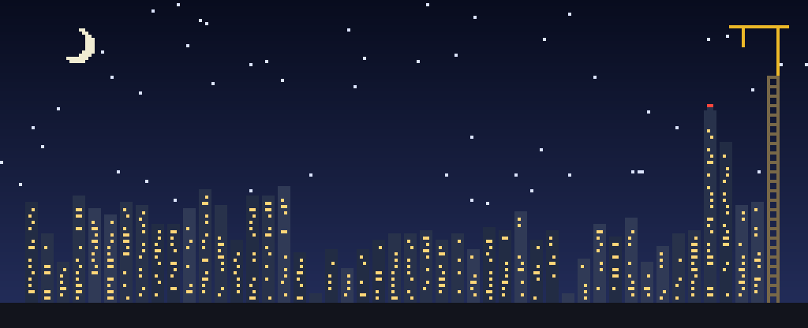
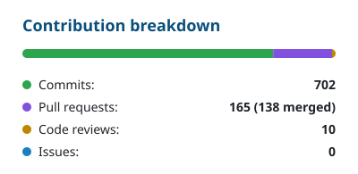

  
   
  
    <b>My GitHub skyline</b>: every building is one week of my contributions, oldest on the left, newest on the right. 
    Taller means busier. 🏗️ The crane is this week, still being built. 🔴 The red beacon marks my busiest week. Redrawn every night.
  

  <a href="https://github.com/kadriudijar"><picture><source media="(prefers-color-scheme: dark)" srcset="cards/activity-dark.svg"></picture></a>
  <a href="https://github.com/kadriudijar"><picture><source media="(prefers-color-scheme: dark)" srcset="cards/breakdown-dark.svg"></picture></a>

