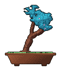
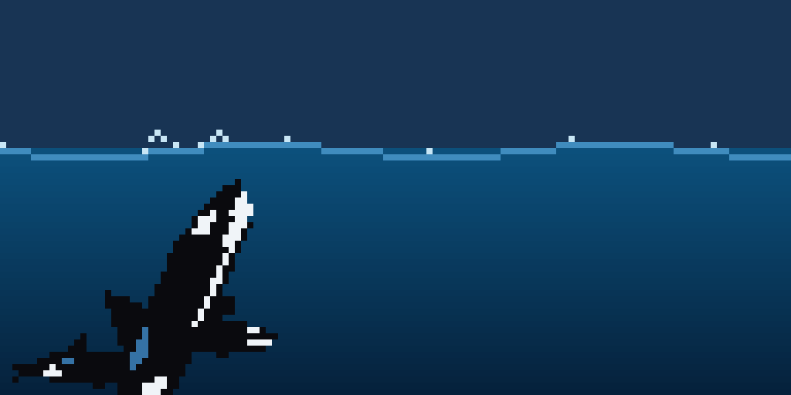
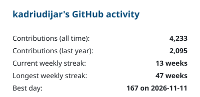
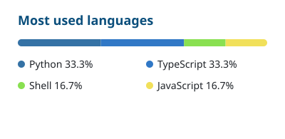

  <!-- widths follow the aspect ratios (bonsai 125×147, orca 2:1) so both are the same height -->
  
  

  <a href="https://github.com/kadriudijar"><picture><source media="(prefers-color-scheme: dark)" srcset="cards/activity-dark.svg"></picture></a>
  <a href="https://github.com/kadriudijar?tab=repositories"><picture><source media="(prefers-color-scheme: dark)" srcset="cards/languages-dark.svg"></picture></a>

